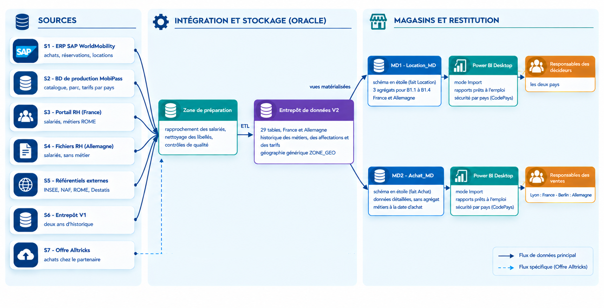
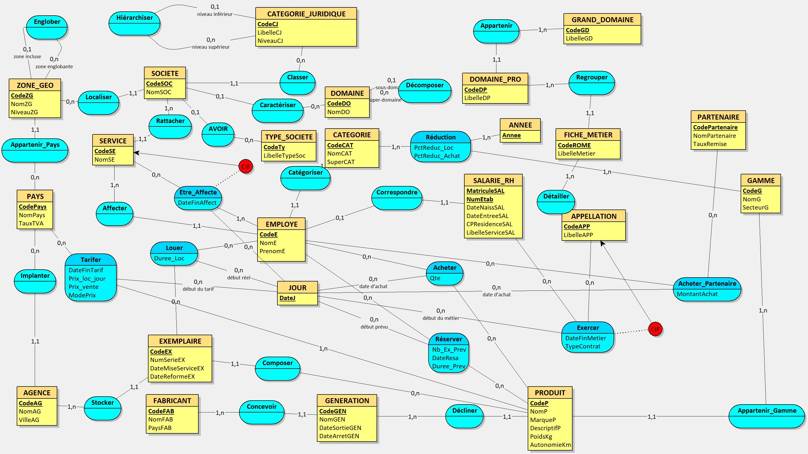

# MobiPass – Conception et développement de bases de données décisionnelles

### Data Engineering | Data Warehouse | Business Intelligence | OLAP

## 📌 Présentation du projet

MobiPass est un projet réalisé dans le cadre du **Master 2 IDA**, dans le cours « Conception et développement de BD décisionnelles ».

L'objectif est de concevoir et mettre en œuvre des solutions décisionnelles permettant de centraliser, structurer et analyser des données afin de faciliter la prise de décision.

Le projet est composé de deux volets complémentaires :

- **Projet 1 :** conception d'un entrepôt de données sous Oracle, création de magasins de données (Data Marts) et exploitation des données avec Power BI.
- **Projet 2 :** conception et développement d'un cube OLAP « Locations » avec SQL Server, SQL Server Analysis Services (SSAS) et MDX.

## 🎯 Objectifs

- Concevoir une architecture décisionnelle adaptée aux besoins d'analyse.
- Mettre en place des entrepôts de données.
- Structurer les données à travers des modèles adaptés à l'analyse multidimensionnelle.
- Concevoir des magasins de données pour répondre à des besoins analytiques spécifiques.
- Développer un cube OLAP et exploiter ses dimensions et mesures.
- Réaliser des analyses multidimensionnelles à l'aide de requêtes SQL et MDX.
- Contrôler la cohérence et la fiabilité des données.
- Exploiter les résultats à travers des outils de Business Intelligence.

---

## 🏗️ Projet 1 – Entrepôt de données Oracle et Data Marts

### Description

Le premier volet porte sur la conception d'un environnement décisionnel reposant sur Oracle.

Il comprend la mise en place d'un entrepôt de données, la création de magasins de données dédiés à différents axes d'analyse ainsi que l'exploitation des données avec Power BI.

### Architecture SAD

### Réalisations

- Conception de l'entrepôt de données sous Oracle.
  
- Développement de scripts SQL pour la gestion et l'alimentation de l'entrepôt.
- Création de deux magasins de données :
  - `md_locations` : magasin de données dédié aux locations.
  - `md_ventes` : magasin de données dédié aux ventes.
- Organisation des données sources et des traitements SQL.
- Réalisation de rapports analytiques sous Power BI.

### Technologies

`Oracle` · `SQL` · `Power BI`

---

## 📊 Projet 2 – Cube OLAP « Locations »

### Description

Le deuxième volet consiste à concevoir un cube OLAP dédié à l'analyse des locations avec **SQL Server et SQL Server Analysis Services (SSAS)**.

L'objectif est de permettre une analyse multidimensionnelle des locations selon plusieurs axes : le temps, les employés, les exemplaires et leurs caractéristiques.

### Réalisations

**1. Conception de l'entrepôt de données**

- Création de la base de données MobiPass sous SQL Server.
- Création du schéma décisionnel `dw`.
- Mise en place de cinq tables et de leurs relations.
- Création d'une dimension temporelle couvrant la période 2023–2026.
- Chargement des données à partir de fichiers CSV avec `BULK INSERT` ou des scripts d'insertion SQL.

**2. Modélisation multidimensionnelle**

Conception d'un cube OLAP organisé autour d'un fait principal : `Location`.

Le cube comprend trois dimensions :

- **Temps :** analyse temporelle avec les hiérarchies mensuelles et semestrielles.
- **Employé :** analyse selon les caractéristiques géographiques et professionnelles.
- **Exemplaire :** analyse selon les produits, gammes, marques, générations et agences.

**3. Développement du cube avec SSAS**

- Création d'un projet multidimensionnel avec Visual Studio.
- Configuration des sources de données.
- Définition des dimensions, hiérarchies et mesures.
- Développement de mesures calculées avec MDX.
- Déploiement et traitement du cube OLAP.

**4. Analyse multidimensionnelle avec MDX**

Développement de requêtes MDX pour analyser différents phénomènes :

- Saturation des exemplaires et disponibilité des produits.
- Analyse des profils d'employés.
- Analyse géographique des locations, notamment en Allemagne.
- Analyse des indicateurs de performance.

**5. Contrôle et validation des données**

Mise en place de contrôles permettant de vérifier la cohérence entre l'entrepôt SQL et le cube OLAP.

Les contrôles portent notamment sur les volumes de données, les règles de gestion et les totaux de référence.

### Technologies

`SQL Server 2022` · `SSAS` · `SSMS` · `Visual Studio 2022` · `MDX` · `Python` · `CSV`

---

## 🛠️ Stack technique globale

| Domaine | Technologies |
|---|---|
| Bases de données | Oracle, SQL Server |
| Langages | SQL, MDX, Python |
| Business Intelligence | Power BI |
| Modélisation décisionnelle | Data Warehouse, Data Marts, Cube OLAP |
| Analyse multidimensionnelle | SSAS |
| Outils | SSMS, Visual Studio |
| Gestion du code | Git, GitHub |

---

## 📸 Résultats et réalisations

### 1. Entrepôt de données et Data Marts – Oracle

*Insérer ici les captures d'écran du modèle de données, des scripts SQL et des magasins de données.*

### 2. Tableaux de bord Power BI

*Insérer ici les captures des rapports et visualisations réalisés avec Power BI.*

### 3. Entrepôt de données – SQL Server

*Insérer ici les captures des tables, relations et résultats des contrôles SQL.*

### 4. Cube OLAP – SSAS

*Insérer ici les captures du cube multidimensionnel, de ses dimensions et de ses mesures.*

### 5. Analyses MDX

*Insérer ici les résultats des requêtes MDX et les analyses multidimensionnelles.*

---

## 💡 Compétences développées

- Conception et modélisation de bases de données décisionnelles.
- Construction d'entrepôts de données.
- Développement de scripts SQL.
- Conception de Data Marts.
- Modélisation multidimensionnelle.
- Développement de cubes OLAP.
- Manipulation de données avec MDX.
- Création de rapports et tableaux de bord Power BI.
- Contrôle de qualité et validation des données.
- Analyse et exploitation des données pour la prise de décision.

## 🎓 Contexte académique

- **Projet :** MobiPass – Conception et développement de BD décisionnelles.
- **Formation :** Master 2 IDA.
- **Année :** 2026.

## 🔗 Code source

Retrouver l'ensemble des scripts SQL, les fichiers de données, les projets SSAS, les requêtes MDX et les documents de conception sur GitHub :

[Consulter le dépôt GitHub – Projet MobiPass](https://github.com/JahidHicham/projet_mobipass)

---

*Projet académique mettant en pratique les concepts de Data Engineering, Data Warehousing, OLAP et Business Intelligence.*
